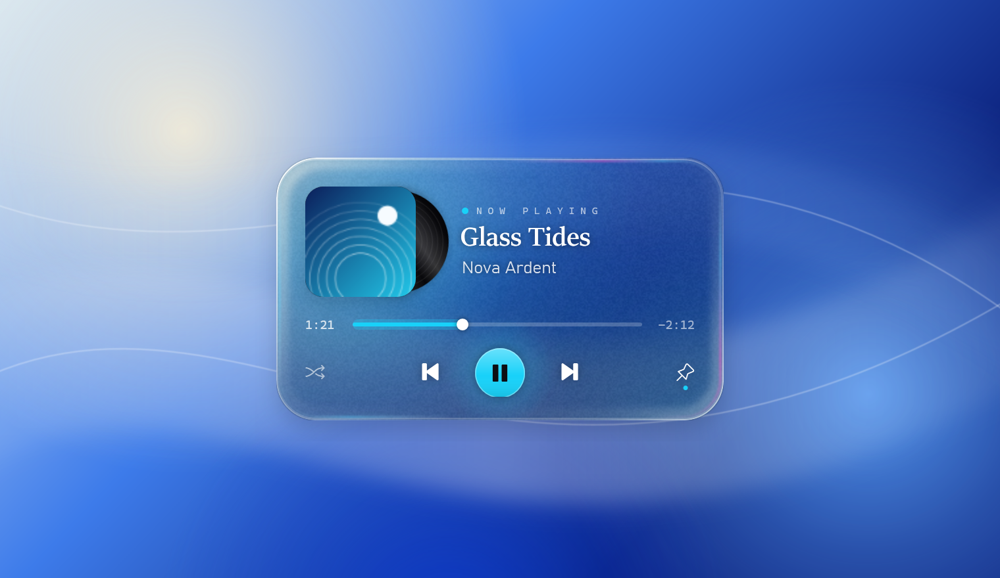
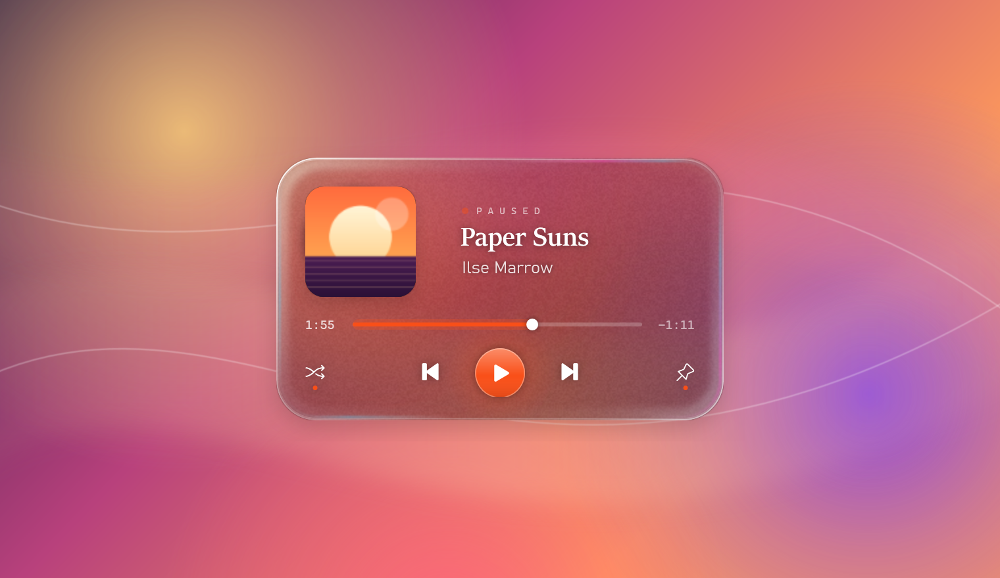
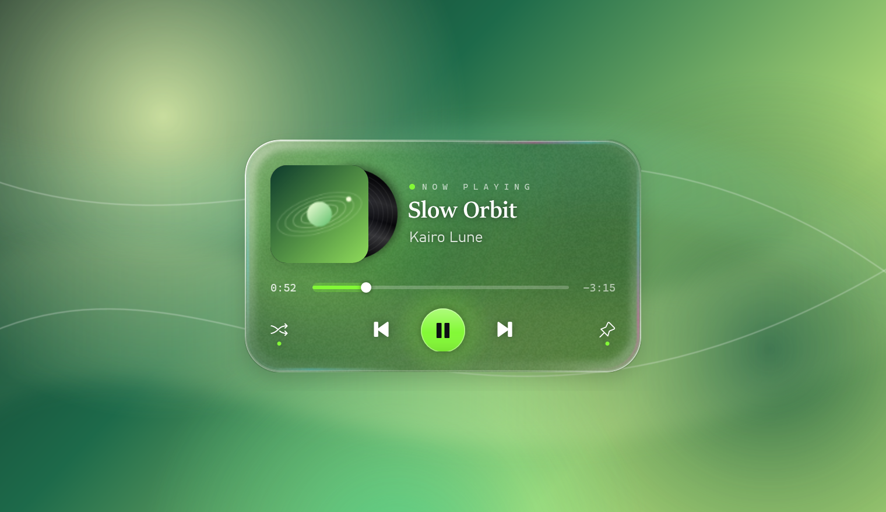

<div align="center">

# Glass Player

**A liquid-glass mini player for Spotify on Windows.**
Late-night vinyl, under glass: a tiny desktop widget that takes its colour from whatever you're listening to.


</div>

---

## Highlights

- **Real frosted glass.** The widget blurs whatever sits behind it with its own blur engine: clean 30 px corners, a thick bright rim, a soft lens ring and a faint pink/cyan refraction fringe.
- **The cover sets the mood.** One accent colour is pulled from each album cover and carried through the play button, progress line, glow and dots. Every song re-themes the card.
- **A record that plays.** A vinyl disc (the cover is its label) slides out of the sleeve and spins while music plays, and tucks back in when you pause.
- **Considered typography.** Editorial serif for the title, a DIN face for the artist, editor-mono numerals for time.
- **Orchestrated motion.** One staggered entrance (sleeve, record, titles, progress line, controls) instead of everything popping in at once.
- **No login, no API keys.** It talks to the Spotify desktop app through Windows' own media controls.
- **Lives quietly.** It appears when Spotify opens and leaves when it closes. Tray icon by the clock; optional start with Windows.

## Gallery

| Playing | Paused | Shuffle on |
|:---:|:---:|:---:|
|  |  |  |

<sub>Rendered by the app's own showcase mode over generated wallpapers, with made-up tracks and generated cover art.</sub>

---

## Design

**Concept.** Two references shaped it: Apple's liquid-glass panels (clear glass, a thick light-catching edge) and the ritual of a record leaving its sleeve. The card is glass and white; the album decides the single loud colour.

| | |
|---|---|
| **Type** | Title in *Sitka Banner* (high-contrast editorial serif) · artist in *Bahnschrift Light* (DIN) · times and the `NOW PLAYING` label in *Cascadia Mono*. All three ship with Windows, so nothing has to be installed. |
| **Colour** | The most vivid pixel of the cover becomes the accent (saturation and brightness are pushed into a usable range; grey covers fall back to warm paper white). A second, quieter colour from the cover's corner tints the opposite glow. The glyph on the play disc flips between ink and white based on the accent's luminance. |
| **Glass** | Captured backdrop → 1/3 scale → 3-pass separable box blur (≈ Gaussian) → vibrance boost. On top: smoke for legibility, a radial album aura, a tiled frosted grain, a glare, and edges drawn in real pixels: 1 px outer hairline, 1 px inner hairline, a soft scaled glow and a refraction fringe. |
| **Motion** | Entrance is staggered 40 → 580 ms with eased fades and small rises. The play/pause glyph morphs with a spring. Track changes slide the titles, pop the cover and cross-fade the accent. The record slides out with a slight overshoot and spins at 15 fps (the grooves are circular, so it reads smooth). |

## Engineering notes

**Talking to Spotify.** `GlobalSystemMediaTransportControlsSessionManager` (Windows media session API) gives title, artist, cover thumbnail, playback state, shuffle and timeline, and exposes play/pause, next, previous, shuffle and seek. There's no Spotify Web API, OAuth or Premium requirement. The progress bar extrapolates position between the app's timeline updates.

**Glass without the grey box.** Windows' built-in blur-behind ignores window regions, so rounded corners showed a grey square. Instead the window marks itself `WDA_EXCLUDEFROMCAPTURE`, which lets it read the screen *behind itself* with GDI. A cheap hash skips work when nothing behind it changed, and the result is shown inside a properly anti-aliased rounded clip with its own drop shadow.

**Sharp at any size.** The layout scales through a `Viewbox`, which puts things on fractional pixels. Hairlines, glows and the cover art are therefore drawn *outside* it, on whole pixels, with sizes recomputed on resize. Text shadows are separate blurred copies, so the real glyphs are never rasterised by an effect.

**Cheap to keep open.** It's a layered window, so each animation frame re-uploads the whole surface. Static layers (glass stack, rims, record, cover, controls) are `BitmapCache`d, live effects were removed from anything that updates often, and the progress bar moves in half-unit steps. Idle it's around 1% of one core; while the record spins, roughly 5–10% of one core (well under 1% of a modern CPU). The spin can be switched off from the tray.

**Windowing.** Borderless, drag anywhere, resize from the edges with the aspect ratio locked in `WM_SIZING`. The window remembers its position, size and pin state. It's single-instance (opening it again brings the player back) and has a tray icon with a dark menu. Start with Windows uses the HKCU `Run` key.

## Install and run

Requirements: Windows 10 2004+ or Windows 11, the Spotify desktop app, and the [.NET 8 SDK](https://dotnet.microsoft.com/download/dotnet/8.0) to build.

```powershell
git clone https://github.com/MugheezAsif/glass-player.git
cd glass-player
dotnet publish GlassPlayer.csproj -c Release -r win-x64 --self-contained false -p:PublishSingleFile=true -o dist
.\dist\GlassPlayer.exe
```

Open Spotify and the player appears. Windows 11 parks new tray icons under the **^** arrow; drag it next to the clock, or switch it on in *Settings → Personalization → Taskbar → Other system tray icons*.

| Action | How |
|---|---|
| Play / pause, previous, next, shuffle | buttons on the card |
| Seek | click the progress line |
| Always on top | pin button, or the tray menu |
| Move / resize | drag the card / drag its edges |
| Hide until Spotify reopens | **×** (appears on hover) |
| Quit | **Shift + ×**, or tray → *Quit Glass Player* |
| Spinning record, start with Windows | tray menu |

## Project structure

```
MainWindow.xaml(.cs)   layout · media session · glass engine · drag/resize · placement
Deck.cs                record slide/spin · album accent · staggered entrance · grain
Showcase.cs            renders the README images and the preview animation
Tray.cs                tray icon, menu, start with Windows
App.xaml(.cs)          button styles · single instance
Settings.cs            saved placement and preferences
tools/                 make-icon.ps1 (app icon) · make-showcase.ps1 (README media)
```

**Regenerating the media:** build, then run `powershell -ExecutionPolicy Bypass -File tools\make-showcase.ps1` (needs `ffmpeg`). It renders the stills, records the entrance in slow motion, and assembles `preview.gif` / `preview.mp4`.

**Debug helpers:** `GLASSPLAYER_DEBUGSHOT=<file.png>` renders the live widget to a PNG after 4 s. `GLASSPLAYER_PROFILE=<file.txt>` logs backdrop-capture timings.

## Known limitations

- Because it reads what's behind it, the widget is excluded from screenshots and screen sharing.
- It controls the Spotify **desktop** app on the same PC. It doesn't reach Spotify on other devices or in the browser.
- Liking, playlists and queue aren't available through Windows' media controls.

## License

[MIT](LICENSE) © 2026 Mugheez Asif

Glass Player is an independent project and is not affiliated with or endorsed by Spotify. "Spotify" is a trademark of Spotify AB.
